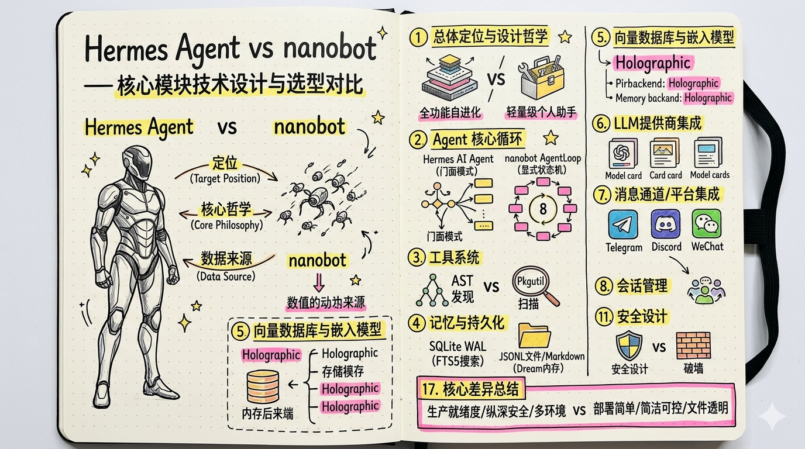
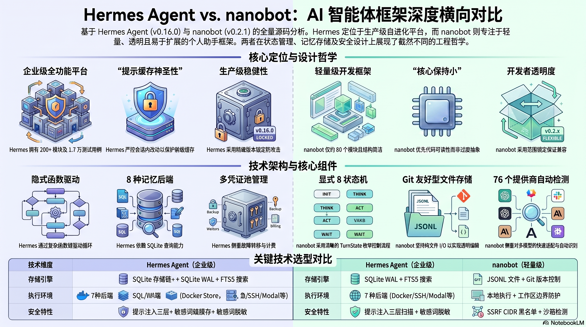

# Hermes Agent vs nanobot — 核心模块技术设计与选型对比

> 基于两份架构文档 + 源码深度分析的横向对比，聚焦技术设计决策和具体技术选型差异。
>
> **数据来源**: hermes-agent-main (v0.16.0) / nanobot-main (v0.2.1) 全量源码

相关解读：[Hermes Agent 架构设计](hermes-agent.md) · [nanobot 架构设计](nanobot.md)。

---

## 目录

1. [总体定位与设计哲学](#1-总体定位与设计哲学)
2. [Agent 核心循环](#2-agent-核心循环)
3. [工具系统](#3-工具系统)
4. [记忆与持久化](#4-记忆与持久化)
5. [向量数据库与嵌入模型](#5-向量数据库与嵌入模型)
6. [LLM 提供商集成](#6-llm-提供商集成)
7. [消息通道 / 平台集成](#7-消息通道--平台集成)
8. [会话管理](#8-会话管理)
9. [上下文管理与压缩](#9-上下文管理与压缩)
10. [配置系统](#10-配置系统)
11. [安全设计](#11-安全设计)
12. [扩展系统](#12-扩展系统)
13. [定时任务](#13-定时任务)
14. [核心依赖技术栈](#14-核心依赖技术栈)
15. [前端 / UI 技术栈](#15-前端--ui-技术栈)
16. [构建、测试与质量工程](#16-构建测试与质量工程)
17. [核心差异总结](#17-核心差异总结)

---

## 1. 总体定位与设计哲学

| 维度 | Hermes Agent | nanobot |
| ---- | ---- | ---- |
| **定位** | 全功能自进化 AI Agent 平台 | 轻量级个人 AI 助手框架 |
| **核心哲学** | "提示缓存是神圣的，核心是窄腰" | "核心保持小，优先重复而非过度抽象" |
| **缓存策略** | 会话内禁止切换工具集/系统提示，以保护前缀缓存 | 无强制缓存约束 |
| **依赖管理** | 精确锁定 `==X.Y.Z`（防供应链攻击） | 范围锁定 `>=X.Y,<Z`（兼容性优先） |
| **新功能策略** | 6 级阶梯：扩展现有 → CLI+技能 → 服务门控 → 插件 → MCP → 核心工具 | 简单 2 层：pkgutil 扫描 + entry_points |
| **代码规模** | 200+ Python 模块, ~17,000 测试用例 | ~80 Python 模块 |
| **版本** | v0.16.0 | v0.2.1 |

---

## 2. Agent 核心循环

| 维度 | Hermes Agent | nanobot |
| ---- | ---- | ---- |
| **核心类** | `AIAgent` (run_agent.py, ~5300行) 委托 `conversation_loop.py` (~3900行) | `AgentLoop` (loop.py, ~1800行) 委托 `AgentRunner` (runner.py, ~1200行) |
| **架构模式** | **门面模式**: AIAgent 是薄门面，实际逻辑分散在 agent/ 子模块 | **直接持有**: AgentLoop 直接引用 runner/provider/sessions 等组件 |
| **状态管理** | 无显式状态机，通过函数调用链驱动 | **显式 8 状态 TurnState 枚举**: RESTORE → COMPACT → COMMAND → BUILD → RUN → SAVE → RESPOND → DONE |
| **并发模型** | 全局持久化事件循环 + 工作线程本地循环 + 同步/异步桥接 `_run_async()` | asyncio 原生: per-session `_session_locks` + 全局 `Semaphore` (默认 3) |
| **消息总线** | 无独立消息总线，通过 gateway/run.py 直接分发 | `MessageBus` (asyncio.Queue): 双向解耦 Channels 与 AgentLoop |
| **迭代控制** | `IterationBudget` 类, max_iterations=90 | 直接在 `AgentRunSpec` 中 max_iterations (默认 200) |
| **Mid-turn 注入** | 不支持 | 支持: `_pending_queues` + `_try_drain_injections()` (最多 5 周期) |
| **流式处理** | `interruptible_streaming_api_call()` 统一处理 3 种 api_mode | `chat_stream()` + `on_content_delta`/`on_thinking_delta`/`on_tool_call_delta` 三回调 |
| **错误恢复** | 15+ 类 `FailoverReason` + 凭证轮换 + 模型回退链 | Length Recovery(3次) + Empty Retry(2次) + Goal Continuation |
| **持续目标** | 无原生支持 | 原生: `goal_active_predicate` + `sustained_goal_active()` + 无限自动继续 |

**选型差异**: Hermes 侧重**生产级稳定性**（多凭证池故障转移、提示缓存保护、15 类错误分类），nanobot 侧重**简洁可控**（显式状态机、原生 asyncio、MessageBus 解耦）。

---

## 3. 工具系统

| 维度 | Hermes Agent | nanobot |
| ---- | ---- | ---- |
| **注册机制** | 模块级 `registry.register()` 自注册 + AST 解析发现 | `Tool(ABC)` 子类 + `ToolLoader` pkgutil 扫描 + entry_points |
| **注册表** | `ToolRegistry` (tools/registry.py, ~400行) — 全局单例 | `ToolRegistry` (agent/tools/registry.py, ~180行) — 实例化 |
| **工具基类** | 无强类型基类，通过 `register()` 函数注册 handler + schema dict | `Tool(ABC)` — 强制实现 name/description/parameters 属性 |
| **参数验证** | 无内置验证框架，`coerce_tool_args()` 集中转换 | 内置 JSON Schema 验证链: 类型/枚举/范围/长度/必填 + `Tool.cast_params()` |
| **工具发现** | AST 解析源码 → `_module_registers_tools()` 检查是否调用了 register | `pkgutil.walk_packages()` → 查找 Tool 非抽象子类 + `_plugin_discoverable` |
| **工具数量** | ~40+ 核心工具 | ~23+ 内置工具 |
| **执行环境** | **7 种后端**: local/docker/ssh/modal/daytona/singularity (统一 `ExecutionEnvironment` ABC) | local 为主，shell/exec 分离 |
| **并发执行** | 最多 8 个工作线程: `_execute_tool_calls_concurrent()` | `concurrent_tools` 布尔开关 |
| **工具守卫** | `ToolGuardrailController`: 幂等/变更分类 + 循环检测阈值 (2-warn / 8-halt / 5-block) | 无独立守卫层 |
| **可用性检查** | `check_fn` + 30秒 TTL 缓存 | `Tool.enabled(ctx)` 方法 |
| **MCP 支持** | 内置 MCP 客户端 + 可选 MCP 服务器目录 | 内置 MCP 工具 (`agent/tools/mcp.py`) |

**选型差异**: Hermes 的工具系统更**工程化**（多环境后端、AST 发现、守卫机制），nanobot 更**面向对象**（强类型 Tool ABC、内置 Schema 验证）。

---

## 4. 记忆与持久化

| 维度 | Hermes Agent | nanobot |
| ---- | ---- | ---- |
| **存储引擎** | SQLite WAL 模式 + FTS5 全文搜索 | 纯文件 I/O: JSONL (会话/历史) + Markdown (记忆) |
| **数据库** | `~/.hermes/state.db` — sessions/messages/messages_fts 三表 | 无数据库，纯文件系统 |
| **会话格式** | SQL 行存储，支持链式结构 (parent_session_id) | JSONL 文件，第一行元数据，后续行消息 |
| **内置记忆** | `MemoryStore`: MEMORY.md + USER.md, 条目用 `§` 分隔 | `MemoryStore`: SOUL.md + USER.md + memory/MEMORY.md + history.jsonl |
| **记忆后端** | `MemoryProvider` ABC → 8 个插件后端 (Honcho/Mem0/Holographic 等), 一次仅激活一个 | 无可插拔后端，纯本地 `MemoryStore` + `Consolidator` |
| **记忆同步** | 每轮后 `sync_turn()` + 每轮前 `prefetch()` | 每轮后 `append_history()` |
| **压缩机制** | `ContextCompressor` (~600行): 75% 阈值 + 头尾保护 + 迭代总结 | `Consolidator` (~300行): 按 user-turn 边界 + consolidation_ratio (默认 0.5) |
| **全文搜索** | FTS5 虚拟表，支持模糊/短语/前缀搜索 | 无内置搜索，仅关键字 grep |
| **Git 版本控制** | 无 | `GitStore` (dulwich >=0.22.0): SOUL.md/USER.md/MEMORY.md 自动 git 追踪 |
| **原子写入** | SQLite WAL 原生保证 | 临时文件 + `os.fsync()` + `os.replace()` |
| **并发控制** | WAL 多读单写 + 15 次重试 + 随机抖动 | `threading.Lock` 保护 cursor 分配 |
| **序列化** | JSON (`json.dumps`) + SQLite BLOB (Holographic HRR 向量) | JSON Lines (`json.dumps + \n`) + Markdown |
| **Dream 记忆** | 无 | 两阶段: Consolidator(实时) → Dream(定时, 每 2h LLM 编辑 SOUL/USER/MEMORY) |

**选型差异**: Hermes 选 SQLite 追求**查询能力**（FTS5 搜索、链式会话），nanobot 选文件 I/O 追求**简洁透明**（文件可直接查看编辑、Git 友好、Dream 自主巩固）。

---

## 5. 向量数据库与嵌入模型

| 维度 | Hermes Agent | nanobot |
| ---- | ---- | ---- |
| **通用向量数据库** | **不使用** ChromaDB/FAISS/Pinecone/Qdrant 等通用向量库 | **不使用**任何向量数据库 |
| **向量搜索方式** | 通过记忆插件委托给各自的托管服务 | 无向量搜索能力 |
| **本地向量方案** | **Holographic**: HRR (Holographic Reduced Representations) — SHA-256 → 1024维相位向量, SQLite BLOB 存储, FTS5+Jaccard+信任分 混合检索 | 无 |
| **云端向量方案** | Honcho (honcho-ai==2.0.1) / Mem0 (mem0ai) / Hindsight (hindsight-client==0.6.1) / Supermemory / OpenViking / RetainDB / ByteRover | 无 |
| **嵌入模型** | Holographic: 本地确定性 HRR 编码 (numpy, 无模型); 云端: 各托管服务自带 | 无嵌入模型 |
| **RAG 实现** | 通过 `MemoryProvider.prefetch(query)` 实现语义召回 → 注入上下文 | 无 RAG, 仅基于最近历史 + 文件内容 |
| **检索策略** | Holographic: FTS5 候选 → Jaccard 重排 → 信任加权 → 可选时间衰减 | 无 |

### 5.1 Hermes 记忆后端详细技术栈

Hermes 通过 `MemoryProvider` ABC + `MemoryManager` 编排器实现可插拔记忆。一次仅允许激活一个外部插件提供者（防止工具模式膨胀和冲突），内置 MEMORY.md/USER.md 记忆始终可用。

| 记忆后端 | 依赖包 | 向量/搜索引擎 | 嵌入模型 | 存储位置 | 核心能力 | 工具集 |
| ---- | ---- | ---- | ---- | ---- | ---- | ---- |
| **Mem0** | `mem0ai` | Mem0 Platform 托管向量库 | 服务端 LLM 事实提取（自动去重） | 云端 API (`app.mem0.ai`) | 语义搜索 + reranking + 自动事实提取 + 去重 | mem0_profile / mem0_search / mem0_conclude |
| **Honcho** | `honcho-ai==2.0.1` | Honcho 托管向量 | Honcho AI-native 模型 | 云端 API | 跨会话用户建模 + 辩证 Q&A + 持久结论 | honcho_profile / honcho_search / honcho_reasoning / honcho_context / honcho_conclude |
| **Holographic** | `numpy==2.4.3` (可选) | SQLite FTS5 + HRR 相位向量 | 本地确定性 HRR 编码 (SHA-256 → 1024维) | 本地 SQLite BLOB | 代数推理 (bind/unbind/bundle) + 混合检索 (FTS5→Jaccard→信任分) | fact_store / fact_feedback |
| **Hindsight** | `hindsight-client==0.6.1` | Hindsight 知识图 | 多模型: OpenAI/Anthropic/Gemini/Groq/Ollama/LMStudio | 云端/本地 | 知识图 + 实体解析 + 多策略检索 | hindsight_recall / hindsight_store |
| **Supermemory** | `supermemory` | Supermemory API 托管 | Supermemory 托管 | 云端 API | 语义长期记忆 + 自动捕获 + 混合检索 | supermemory_search / supermemory_store |
| **OpenViking** | `httpx` | OpenViking 知识库 | OpenViking 托管 | 本地/云端 | 分层上下文加载 + 自动提取 | openviking_recall / openviking_store |
| **RetainDB** | `requests` | RetainDB 云 | RetainDB 托管 | 云端 API | 混合搜索 + 7 种记忆类型 + 合成 | retaindb_search / retaindb_store |
| **ByteRover** | `brv` CLI | ByteRover 知识树 | ByteRover LLM | 本地文件树 | 持久知识树 + 分层检索 | byterover_recall / byterover_store |

#### Mem0 技术细节

- **SDK**: `mem0ai` (MemoryClient 类), 通过 `client.search()` / `client.add()` / `client.get_all()` 三个核心 API 交互
- **认证**: MEM0_API_KEY 环境变量 或 `$HERMES_HOME/mem0.json` 配置文件
- **用户隔离**: user_id + agent_id 两级过滤（读操作仅按 user_id，写操作按 user_id + agent_id）
- **并发模型**: 后台线程异步同步 (`threading.Thread`, daemon=True)，prefetch 和 sync 各一个线程
- **容错机制**: 断路器模式 — 连续 5 次失败后暂停 API 调用 120 秒
- **事实提取**: 服务端 LLM 自动从对话中提取事实 (`client.add(messages)`)，支持 `infer=False` 模式直接存储（不做 LLM 推理）
- **检索**: 语义搜索 + 可选 reranking (`rerank=True`), top_k 最大 50
- **数据流**: 每轮对话后 `sync_turn()` → 后台线程调 `client.add()` → Mem0 服务端 LLM 提取事实; 每轮对话前 `queue_prefetch()` → 后台线程调 `client.search()` → 结果注入上下文

**选型差异**: Hermes 通过**插件化记忆系统**支持多种向量搜索方案（8 个后端），但核心不依赖通用向量库; nanobot **完全不使用向量技术**，设计哲学是"好的记忆不是一堆笔记，而是一个安静的注意力系统"。

---

## 6. LLM 提供商集成

| 维度 | Hermes Agent | nanobot |
| ---- | ---- | ---- |
| **适配层** | `agent/transports/` — `ProviderTransport` ABC: 消息/工具/响应全链路转换 (策略模式) | `providers/base.py` — `LLMProvider` ABC: chat/chat_stream + 内置重试 |
| **API 模式** | 4 种 Transport: chat_completions / anthropic_messages / bedrock_converse / codex_responses | 6 种 backend: openai_compat / anthropic / azure_openai / bedrock / openai_codex / github_copilot |
| **提供商数量** | 16+ 直接支持 (通过 Transport 层), 50+ 通过 OpenRouter 网关 | **76 个** ProviderSpec SSOT 注册表（含网关/本地/OAuth） |
| **提供商发现** | 无自动检测，显式配置 api_mode | **自动检测**: API key 前缀 (`sk-or-` → OpenRouter) + api_base URL 关键字 + 模型名匹配 |
| **动态提供商** | 不支持 | 支持: `create_dynamic_spec()` 为自定义端点创建运行时 ProviderSpec |
| **OpenAI SDK** | `openai==2.24.0` (精确固定) | `openai>=2.8.0` (无上限) |
| **Anthropic SDK** | `anthropic==0.87.0` (可选, 延迟安装) | `anthropic>=0.45.0,<1.0.0` (核心依赖) |
| **故障转移** | `CredentialPool` 多凭证池 (4 种轮换策略: fill_first/round_robin/random/least_used) + 回退链 | `FallbackProvider` 包装器 + fallback_models 链 + 断路器 (3 次失败后断开, 60s 冷却) |
| **重试策略** | `jittered_backoff()` 带随机抖动, 错误分类驱动 | 固定延迟 (1s, 2s, 4s) + persistent 模式 (最大 60s, 相同错误 10 次停止) |
| **错误分类** | **15+ 类 FailoverReason** 枚举 + `ClassifiedError` 带恢复提示 (retryable/should_compress/should_rotate/should_fallback) | 瞬时/永久错误标记 + 429 细分为配额/速率, `_is_transient_response()` 多层判断 |
| **提示缓存** | `apply_anthropic_cache_control()`: "system_and_3" 策略 (系统提示 + 最后 3 条消息), 支持 5m/1h TTL | `supports_prompt_caching` 标志 (仅 Anthropic OpenRouter) |
| **思维链** | 通过 Transport 层处理 Anthropic 思维块签名保序 | `thinking_style` 5 种风格 + `reasoning_as_content` + 模型级自动检测 (Kimi/MIMO) |
| **流式** | 统一 `interruptible_streaming_api_call()` 处理 4 种 api_mode, 支持流式中断恢复 | `chat_stream()` + 3 个增量回调 + 90s 空闲超时 |
| **计费跟踪** | `CanonicalUsage` + `PricingEntry` + `CostResult` + Nous 信用头跟踪 (`x-nous-credits-*`) | usage 字段在 `LLMResponse` 中, 无定价计算 |
| **凭证源** | 环境变量/.env/Bitwarden Secrets Manager/Claude Code 凭证/OAuth 设备码 | 环境变量 (env_key 在 ProviderSpec 中声明) |
| **认证方式** | API key + OAuth Bearer + Claude Code 凭证同步 | API key 为主, OAuth (Codex/Copilot), Azure Identity |

**选型差异**: Hermes 的提供商层更**企业级**（Transport 策略模式、多凭证池、计费跟踪、Bitwarden），nanobot 更**开发者友好**（76 个 SSOT 注册表、自动检测、动态创建、断路器故障转移）。

---

## 7. 消息通道 / 平台集成

| 维度 | Hermes Agent | nanobot |
| ---- | ---- | ---- |
| **通道基类** | `BasePlatformAdapter(ABC)` — connect/disconnect/send + 能力标志 | `BaseChannel(ABC)` — start/stop/send + send_delta 流式 |
| **通道发现** | `gateway/platform_registry.py` 注册表 + 插件注册 | `ChannelManager._init_channels()` pkgutil 扫描 + entry_points |
| **平台数量** | 20+ (Telegram/Discord/Slack/WhatsApp/WeChat/QQ/Feishu/Email/SMS/Matrix/Signal...) | 20+ (基本一致, 额外 MoChat/MS Teams) |
| **消息路由** | gateway/run.py (~800KB) 网关启动器 + delivery.py 投递路由 | `MessageBus` (asyncio.Queue, 44行) + `ChannelManager._dispatch_outbound()` |
| **流式支持** | 通道级: supports_code_blocks 等能力标志 | 通道级: `send_delta()` + `send_reasoning_delta()` 可选覆盖 |
| **权限管理** | `SessionSource.role_authorized` + 批准回调 | 三层: `*` > allowlist > pairing store |
| **配对机制** | 通过 approval callback 实现 | 内置配对码: `generate_code()` + `PAIRING_CODE_META_KEY` |
| **消息合并** | 无 | 流式 delta 合并 + 重复抑制 (内容指纹) |
| **Webhook 安全** | `_HERMES_WEBHOOK_SAFE_TOOLS` 仅 4 个只读工具 | 无独立 Webhook 安全工具集 |
| **斜杠命令** | `hermes_cli/commands.py` — `CommandDef` + 跨平台统一 | `command/router.py` — priority/exact/prefix 三层分发 |
| **平台 SDK** | Telegram: python-telegram-bot==22.6, Discord: discord.py==2.7.1, Slack: slack-bolt==1.27.0 | Telegram: python-telegram-bot>=22.6, Discord: discord.py>=2.5.2, Slack: slack-sdk>=3.39.0 |

---

## 8. 会话管理

| 维度 | Hermes Agent | nanobot |
| ---- | ---- | ---- |
| **存储格式** | SQLite 关系型 (sessions + messages 表) | JSONL 文件 (每会话一个文件) |
| **会话键** | session_id (UUID) | `channel:chat_id` 或 `unified:default` |
| **统一会话** | 无 (每个来源独立) | 可选: `unified_session: true` 跨渠道统一会话 |
| **会话分支** | 支持: parent_session_id + end_reason='branched' | 支持: `fork_session_before_user_index()` |
| **会话压缩** | 链式结构: 压缩续集 (parent_session_id, end_reason='compression') | `last_consolidated` 索引标记 |
| **TTL** | 无自动过期 | 可选: `session_ttl_minutes` (默认 0 = 无限) + `AutoCompact` 空闲压缩 |
| **损坏恢复** | SQLite 自动修复 | `_repair()` 方法: 跳过损坏 JSON 行, 保留可恢复消息 |
| **原子性** | SQLite WAL | 临时文件 + `os.fsync()` + `os.replace()` + 目录 fsync |

---

## 9. 上下文管理与压缩

| 维度 | Hermes Agent | nanobot |
| ---- | ---- | ---- |
| **构建器** | `prompt_builder.py` (~1600行) — 25+ 函数 | `context.py` (~300行) — `ContextBuilder` 单类 |
| **系统提示组成** | 身份声明 + 技能索引 + 上下文文件扫描 (AGENTS.md/.cursorrules) + 记忆块 + 提示注入扫描 | 身份 (identity.md) + Bootstrap (AGENTS.md/SOUL.md/USER.md) + 工具契约 + 长期记忆 + 活跃技能 + 最近历史 (50 条, 32KB) |
| **压缩触发** | 75% 上下文窗口阈值 | consolidation_ratio (默认 0.5) |
| **头尾保护** | protect_first_n=3, protect_last_n=6 | 按 user-turn 边界选择驱逐区域 |
| **压缩方法** | 工具输出修剪 → 迭代式 LLM 总结 → token 预算尾部保护 | LLM 生成摘要 → append 到 history.jsonl, 失败时 raw_archive |
| **轨迹压缩** | `TrajectoryCompressor` (~1400行): 训练数据专用, OpenRouter API 生成摘要 | 无独立轨迹压缩 |

---

## 10. 配置系统

| 维度 | Hermes Agent | nanobot |
| ---- | ---- | ---- |
| **配置格式** | YAML (`config.yaml`) | JSON (`config.json`) |
| **配置验证** | PyYAML==6.0.3 + ruamel.yaml==0.18.17 (保留注释), Pydantic 用于 API 数据 | Pydantic v2 (>=2.12.0) + pydantic-settings: 完整模型验证, camelCase 别名 |
| **密钥管理** | `.env` 仅存 API keys, config.yaml 存行为配置 | 环境变量, env_key 在 ProviderSpec 声明 |
| **配置路径** | `~/.hermes/config.yaml` + `~/.hermes/.env` | `~/.nanobot/config.json` |
| **配置迁移** | 无显式迁移 | `_migrate_config()` 自动迁移旧格式 |
| **环境变量引用** | 无 | 支持 `${VAR}` 引用环境变量 |
| **热加载** | 无 | 部分配置支持运行时重载 |

---

## 11. 安全设计

| 维度 | Hermes Agent | nanobot |
| ---- | ---- | ---- |
| **文件防护** | 精确路径黑名单 (SSH key/.env/.netrc/sudoers...) + 前缀目录黑名单 | 工作区边界: `is_path_within()` + `require_path_within()` |
| **网络安全** | `url_safety.py` URL 安全检查 + `path_security.py` 路径安全检查 | SSRF 保护: RFC1918/链路本地/云元数据 CIDR 黑名单 + 白名单机制 |
| **提示注入** | `threat_patterns.py` 共享库: context/memory/tool-result 三层扫描 | 无独立注入检测 |
| **SSL** | `ssl_guard.py` 自定义 SSL 守卫 | 依赖 httpx 默认 SSL |
| **敏感信息** | `RedactingFormatter`: 自动编辑日志中的 API 密钥/令牌/密码 | 无自动编辑 |
| **沙箱** | 7 种执行环境 (docker/ssh/modal 等) | 系统沙箱检测 (macOS App Sandbox/Bubblewrap) + PTH 文件守卫 |
| **工具集隔离** | 按信任等级: CLI/Gateway/Webhook/Cron 四层, Webhook 仅 4 个只读工具 | 按工作区 access_mode (restricted/full) + Tool._scopes |

**选型差异**: Hermes 安全体系更**纵深**（提示注入扫描、RedactingFormatter、四层工具集隔离），nanobot 更**边界清晰**（SSRF CIDR 黑名单、工作区路径检查、PTH 守卫）。

---

## 12. 扩展系统

| 维度 | Hermes Agent | nanobot |
| ---- | ---- | ---- |
| **插件发现** | 四层: 捆绑 → 用户 → 项目 → Pip (后覆盖前) | 两层: pkgutil 扫描 + entry_points |
| **插件清单** | `plugin.yaml` (name/version/dependencies/hooks/kind/requires_env) | 无清单文件，通过 entry_points 注册 |
| **插件 API** | `PluginContext` 门面: register_tool/platform/memory/model/command/hook | 无统一 API，直接通过 ToolLoader/ChannelManager 发现 |
| **钩子事件** | 12+ 事件: pre/post_tool_call, pre/post_llm_call, session_start/end, gateway_dispatch, approval 等 | `AgentHook`: before/after_run, before/after_iteration, on_stream, on_error |
| **技能系统** | SKILL.md (YAML 前置 + Markdown), 50+ 内置, 技能包支持 | SKILL.md (YAML 前置 + Markdown), 12 内置, 无技能包 |
| **技能加载** | 三层扫描: repo/skills → ~/.hermes/skills → ~/.hermes/skill-bundles + 环境匹配 + 索引缓存 | 单层: nanobot/skills/ 扫描, 需二进制可用性检查 |
| **延迟安装** | `lazy_deps.py`: 允许白名单 + venv 隔离 + 离线检测 + 可配置禁用 | 无延迟安装机制 |
| **编辑器集成** | ACP 适配器 (VS Code/Zed/JetBrains) | 无 |

---

## 13. 定时任务

| 维度 | Hermes Agent | nanobot |
| ---- | ---- | ---- |
| **调度器** | `cron/scheduler.py` — `tick()` 每 60 秒由网关后台线程调用 | `cron/service.py` — `CronService` asyncio 事件循环 |
| **调度类型** | cron / interval / once | at / every / cron |
| **存储** | `~/.hermes/cron/jobs.json` + output/{job_id}/ | `~/.nanobot/cron/` 文件存储 |
| **并发** | 并行池(4) + 顺序池(1), ThreadPoolExecutor | 单线程事件循环 |
| **安全** | 提示注入扫描 + 禁用 messaging/clarify/cronjob 工具 | 无额外限制 |
| **交付** | 多目标: origin/指定平台/@user/#channel | session_key + origin_channel/chat_id |
| **Dream** | 无 | 内置 Dream 记忆巩固 (每 2h, 可配置模型/批次/迭代) |
| **Cron 库** | croniter==6.0.0 | croniter>=6.0.0 |
| **文件锁** | fcntl/msvcrt 跨进程互斥锁 | filelock>=3.25.2 |

---

## 14. 核心依赖技术栈

### 14.1 语言与运行时

| 维度 | Hermes Agent | nanobot |
| ---- | ---- | ---- |
| **Python** | `>=3.11,<3.14` (上限防 Rust 依赖源码构建) | `>=3.11` (3.11/3.12 classifier) |
| **TypeScript** | Ink/React TUI (ui-tui/) + Electron | React 18 WebUI (webui/) + Bridge (WhatsApp) |
| **Node.js** | TUI 需要 | Bridge 需要 `>=20.0.0` |

### 14.2 HTTP 客户端

| 维度 | Hermes Agent | nanobot |
| ---- | ---- | ---- |
| **主选** | **httpx[socks]==0.28.1** (含 SOCKS 代理) | **httpx>=0.28.0,<1.0.0** |
| **备选** | requests==2.33.0 (遗留代码) | 无 requests 依赖 |
| **异步 HTTP** | aiohttp==3.13.4 (仅 messaging extra) | aiohttp>=3.9.0 (API 服务器, 可选) |

### 14.3 异步框架

| 维度 | Hermes Agent | nanobot |
| ---- | ---- | ---- |
| **框架** | asyncio (标准库) + 自定义桥接 (`_run_async()`) | asyncio 原生，无桥接层 |
| **第三方** | 不使用 trio/anyio | 不使用 trio/anyio |

### 14.4 日志

| 维度 | Hermes Agent | nanobot |
| ---- | ---- | ---- |
| **框架** | **Python 标准 logging** + RotatingFileHandler | **loguru>=0.7.3** |
| **日志文件** | agent.log / errors.log / gateway.log / gui.log (4 个日志文件) | stderr 输出 + 可选文件 |
| **特殊功能** | `RedactingFormatter` 自动编辑密钥 + 组件前缀过滤 (6 类) + 会话上下文标签 | `_LoguruBridge` 桥接 stdlib logging → loguru |
| **第三方抑制** | 显式抑制 13 个 noisy logger (openai, httpx, asyncio...) | 通过 loguru filter |

### 14.5 CLI 框架

| 维度 | Hermes Agent | nanobot |
| ---- | ---- | ---- |
| **主选** | **Fire==0.7.1** (脚本入口) + **prompt_toolkit==3.0.52** (交互式 TUI) | **Typer>=0.20.0** + **prompt_toolkit>=3.0.50** + **questionary>=2.0.0** |
| **终端美化** | **Rich==14.3.3** | **Rich>=14.0.0** |
| **命令注册** | `CommandDef` dataclass + 分类 + 别名 | Typer app + `CommandRouter` 三层分发 |

### 14.6 数据验证

| 维度 | Hermes Agent | nanobot |
| ---- | ---- | ---- |
| **主选** | **Pydantic==2.13.4** (API/外部数据) + **dataclass** (内部数据) | **Pydantic>=2.12.0 + pydantic-settings>=2.12.0** (全栈) |
| **JSON 修复** | 无 | **json-repair>=0.57.0** (修复 LLM 生成的格式错误 JSON) |

### 14.7 Token 计数

| 维度 | Hermes Agent | nanobot |
| ---- | ---- | ---- |
| **库** | **tiktoken** (按需导入) | **tiktoken>=0.12.0** (核心依赖) |
| **编码** | 按模型: `tiktoken.encoding_for_model()` | 固定: `tiktoken.get_encoding("cl100k_base")` |

### 14.8 WebSocket

| 维度 | Hermes Agent | nanobot |
| ---- | ---- | ---- |
| **服务端** | **websockets==15.0.1** | **websockets>=16.0,<17.0** |
| **客户端** | 同上 | **websocket-client>=1.9.0,<2.0.0** |
| **Socket.IO** | 无 | **python-socketio>=5.16.0** (MoChat 通道) |

### 14.9 模板引擎

| 维度 | Hermes Agent | nanobot |
| ---- | ---- | ---- |
| **库** | **Jinja2==3.1.6** | **Jinja2>=3.1.0** |

### 14.10 浏览器自动化

| 维度 | Hermes Agent | nanobot |
| ---- | ---- | ---- |
| **库** | **Playwright** (同步 API, 仅 Google Meet 插件) | 无浏览器自动化库 |
| **网页提取** | 无专用库 | **readability-lxml>=0.8.4** + **lxml-html-clean>=0.4.0** |

### 14.11 图像处理

| 维度 | Hermes Agent | nanobot |
| ---- | ---- | ---- |
| **库** | **Pillow==12.2.0** | 无 Pillow 依赖 |

### 14.12 文档处理

| 维度 | Hermes Agent | nanobot |
| ---- | ---- | ---- |
| **PDF** | 无 | **pypdf>=5.0.0** + 可选 **pymupdf>=1.25.0** |
| **Word** | 无 | **python-docx>=1.1.0** |
| **Excel** | 无 | **openpyxl>=3.1.0** |
| **PowerPoint** | 无 | **python-pptx>=1.0.0** |

### 14.13 Web 搜索

| 维度 | Hermes Agent | nanobot |
| ---- | ---- | ---- |
| **引擎** | 通过工具集成 (web_search, web_extract) | **ddgs>=9.5.5** (DuckDuckGo) + Bocha API + VolcEngine |

### 14.14 Web 框架

| 维度 | Hermes Agent | nanobot |
| ---- | ---- | ---- |
| **框架** | **FastAPI>=0.104.0** + **uvicorn>=0.24.0** (仪表板/ACP) | aiohttp (API 服务器) + websockets (网关) |

### 14.15 语音

| 维度 | Hermes Agent | nanobot |
| ---- | ---- | ---- |
| **STT** | **faster-whisper==1.2.1** + **sounddevice==0.5.5** + numpy | 无本地 STT |
| **TTS** | **elevenlabs==1.59.0** / **edge-tts==7.2.7** (可选) | 无 TTS |

### 14.16 认证

| 维度 | Hermes Agent | nanobot |
| ---- | ---- | ---- |
| **JWT** | **PyJWT[crypto]==2.13.0** | **PyJWT>=2.0,<3.0** (MS Teams) |
| **OAuth** | 自定义实现 (设备码 / Loopback PKCE) | **oauth-cli-kit>=0.1.3** |
| **Azure** | **azure-identity==1.25.3** (可选) | **azure-identity>=1.19.0** (可选) |

### 14.17 Git

| 维度 | Hermes Agent | nanobot |
| ---- | ---- | ---- |
| **库** | 无内置 Git 库 | **dulwich>=0.22.0** (纯 Python, 记忆版本控制) |
| **gitignore** | **pathspec==1.1.1** | 无 |

---

## 15. 前端 / UI 技术栈

| 维度 | Hermes Agent | nanobot |
| ---- | ---- | ---- |
| **桌面应用** | Electron | 无 |
| **TUI** | **Ink/React** (TypeScript, ui-tui/) | 无独立 TUI |
| **WebUI** | FastAPI 仪表板 (hermes_cli/web_server.py, ~12000行) | **React 18** + **Vite 5** + **TypeScript 5.7** SPA |
| **样式** | 无前端 CSS 框架 | **Tailwind CSS 3.4** |
| **组件库** | 无 | **Radix UI** (Dialog/Dropdown/Tooltip/Alert 等 6 组件) |
| **国际化** | `agent/i18n.py` (内部) | **i18next** + **react-i18next** |
| **Markdown 渲染** | 无前端渲染 | **react-markdown** + **remark-gfm** + **remark-math** + **rehype-katex** |
| **代码高亮** | 无 | **react-syntax-highlighter** |
| **图标** | 无 | **lucide-react** |
| **前端测试** | 无 | **vitest** + **@testing-library/react** + **happy-dom** |
| **前端构建** | 无 (Ink 独立) | **Vite** → `nanobot/web/dist` (打包进 Python wheel) |
| **Bridge** | 无 | TypeScript WhatsApp Bridge (@whiskeysockets/baileys) |

---

## 16. 构建、测试与质量工程

| 维度 | Hermes Agent | nanobot |
| ---- | ---- | ---- |
| **构建系统** | **setuptools>=77.0,<83** | **Hatchling** |
| **包管理** | **uv** (uv.lock 精确锁定) | **pip** (pyproject.toml 范围锁定) |
| **入口点** | hermes / hermes-agent / hermes-acp (3 个) | nanobot (1 个) |
| **测试框架** | **pytest==9.0.2** + **pytest-asyncio==1.3.0** | **pytest>=9.0.0** + **pytest-asyncio>=1.3.0** + **pytest-cov>=6.0.0** |
| **测试隔离** | 进程级隔离 (scripts/run_tests_parallel.py) + conftest 密封测试 | 标准 pytest 隔离 |
| **测试规模** | ~900 文件, ~17,000 用例 | 标准测试套件 |
| **Lint** | **Ruff==0.15.10** (仅 PLW1514 规则) | **Ruff>=0.1.0** (E/F/I/N/W 规则, 忽略 E501) |
| **类型检查** | **ty==0.0.21** (非 mypy) | 无独立类型检查 |
| **行长限制** | 未显式限制 | 100 字符 |
| **覆盖率** | 无 pytest-cov | **pytest-cov>=6.0.0** |
| **文档站点** | **Docusaurus** | 无文档站点 |

---

## 17. 核心差异总结

| 维度 | Hermes Agent 优势 | nanobot 优势 |
| ---- | ---- | ---- |
| **生产就绪度** | 多凭证池 4 策略轮换、Bitwarden 集成、计费跟踪、提示缓存保护 | 部署简单、配置直观 (Pydantic Settings)、学习曲线低 |
| **可观测性** | 4 个日志文件 + RedactingFormatter + 组件过滤 + 会话上下文标签 | loguru 开箱即用、更简洁、stdlib 桥接 |
| **记忆系统** | 8 个可插拔后端 (Honcho/Mem0/Holographic) + FTS5 搜索 + MemoryManager 编排 | 文件透明可编辑 + Git 版本控制 + Dream 自主巩固 |
| **向量搜索** | Holographic HRR 本地方案 + 6 个云端托管方案 | 无向量依赖，零维护成本 |
| **工具系统** | 7 种执行环境后端 + 守卫机制 + AST 发现 | 强类型 Tool ABC + 内置 JSON Schema 验证 |
| **LLM 提供商** | Transport 策略模式 + 15 类错误分类 + 凭证池 | 76 个 SSOT 注册表 + 自动检测 + 断路器故障转移 |
| **安全纵深** | 提示注入三层扫描 + 敏感信息编辑 + 四层工具集隔离 | SSRF CIDR 黑名单 + 工作区边界清晰 |
| **依赖管理** | 精确版本固定 + lazy_deps 延迟安装 + 供应链防护 | 范围版本灵活 + 无延迟安装复杂度 |
| **代码规模** | 大 (~200 模块), 学习成本高 | 小 (~80 模块), 快速上手 |
| **扩展性** | 四层插件 + PluginContext API + 6 级能力阶梯 | entry_points + pkgutil 自动发现 |
| **前端** | Electron 桌面 + Ink TUI + FastAPI 仪表板 | React 18 + Vite + Tailwind + Radix UI 现代 SPA |
| **文档处理** | 无 | PDF/Word/Excel/PPT 内置支持 |
| **编辑器集成** | ACP 协议 (VS Code/Zed/JetBrains) | 无 |
| **消息架构** | 网关直接分发 (重, 800KB run.py) | MessageBus 解耦 (轻, 44行 queue.py) |

### 总体结论

- **Hermes Agent** 是面向**生产级多租户场景**的全功能 Agent 平台：多凭证池、提示缓存保护、多环境执行、编辑器集成。适合需要高可靠性、多平台部署、企业级安全的场景。代价是复杂度高、学习曲线陡。

- **nanobot** 是面向**个人开发者/小团队**的轻量 Agent 框架：asyncio 原生、显式状态机、文件透明记忆、Git 版本控制、76 个提供商 SSOT。适合快速搭建、二次开发、需要透明可控的场景。优势是简洁、现代前端、文档处理。

---

> **文档生成时间**: 2026-06-16
>
> **数据来源**: hermes-agent-main (v0.16.0) / nanobot-main (v0.2.1) 全量源码 + pyproject.toml + webui/package.json

## 辅助学习配图

保留原始 Gemini 与 NotebookLM 配图供学习对照。图片中存在生成文字错误，具体技术信息需结合正文与对应版本源码核对。

