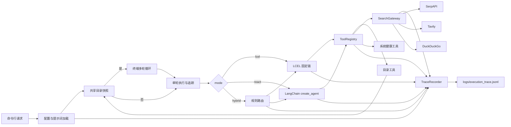
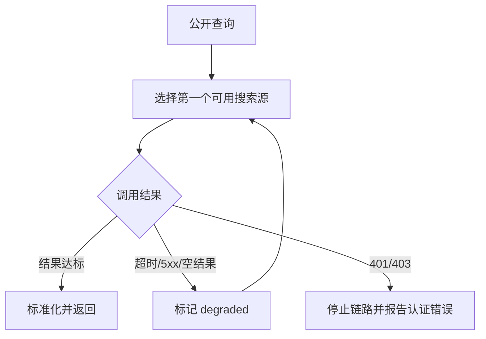

# [技术后端]_MD070_LangChain-Agent_多模式目录分析

## 文档变更记录

| 序号 | 版本 | 责任人 | 时间 | 修改说明 |
| :--- | :--- | :--- | :--- | :--- |
| 1 | 1.0 | 待确认 | 2026-09-21 | 第一版，与首版可运行实现同步 |
| 2 | 1.1 | 待确认 | 2026-09-21 | 增加单文件 JSONL 统一执行追踪 |
| 3 | 1.2 | 待确认 | 2026-10-08 | 增加终端多轮对话，规整模块目录并同步追踪与使用说明 |

## 1. 概述

### 1.1 业务背景

本项目用于演示 LangChain 课程中的 LCEL、Agent、自定义工具、会话记忆和外部检索。主要目标是在明确的只读边界内，对用户指定的 macOS 目录执行统计、分布、重复文件与活跃度分析，同时提供多源网络检索和系统健康摘要。

实现范围：

- 单次命令和持续终端对话入口；
- `lcel`、`react`、`hybrid` 三种处理模式；
- 6 个只读工具；
- SerpAPI、Tavily、DuckDuckGo 多源搜索与降级；
- YAML 提示词和运行配置；
- 进程内短期记忆；
- 任务、路由、工具、搜索源和 Agent 模型步骤的统一追踪。

明确不包含：文件删除、移动、重命名或改写；文件内容上传；跨进程会话持久化；HTTP API 和图形界面。

### 1.2 相关责任人

| 角色 | 责任人 |
| :--- | :--- |
| 需求 | 待确认 |
| 后端开发 | 待确认 |
| 测试 | 待确认 |

### 1.3 相关文档

- 使用说明：`README.md`
- 运行配置：`config/settings.yaml`
- 提示词配置：`config/prompts.yaml`
- 课程参考：`../CASE-工具链组合/`、`../CASE-搭建故障诊断Agent/`

## 2. 总体设计

系统从 `app.py` 接收模式、任务、目录、查询和自然语言指令。`--interactive` 进入 `cli/console.py` 的持续对话循环，默认选用 ReAct；否则执行一次请求。`cli/execution.py` 为两种入口提供统一单轮追踪。`tools/registry.py` 保持单一工具入口；LCEL 和 Agent 使用同一批工具，避免两套业务逻辑。

`audit` LCEL 链并行组合文件统计、类型分布、重复检测和活跃度分析。`InventoryStore` 使用锁保护快照缓存，首个工具扫描后，其他工具复用同一结果。缓存仅存在于当前进程，不写入磁盘。

模块边界：`cli/` 处理终端交互、单轮追踪及报告；`modes/` 选择执行策略；`agent/` 管理 Agent、会话状态和回调；`chains/` 提供固定流程；`tools/registry.py` 注册领域工具，`services/` 与 `search/` 提供底层能力；`core/` 存放跨模块配置、结构和追踪。各模块保留模块级说明，职责不再混放在 Agent 或链目录。

为兼容已有 Python 导入，`agent/tool_registry.py` 与 `chains/report_chain.py` 保留只做转发的兼容模块；新代码分别从 `tools.registry`、`cli.report` 导入。

## 3. 详细设计

### 3.1 目录分析

1. `PathValidator` 展开 `~`、解析真实路径并要求目标必须是目录。
2. 拒绝 `/`、用户主目录本身和任何不在 `allowed_roots` 下的路径。校验对解析后路径生效，用于防止符号链接越界。
3. `DirectoryScanner` 使用 `os.scandir` 迭代扫描，不跟随符号链接，并应用深度、文件数与时间限制。
4. 目录工具仅输出相对路径或根目录名。扫描权限错误以 `warnings` 返回，不会静默忽略。
5. 达到限制时返回已完成的部分结果，并将 `truncated` 设为 `true`。

### 3.2 重复文件检测

首先按文件大小分组，仅对同大小且大小不为 0 的候选文件分块计算 SHA-256。超过 `max_hash_file_mb` 的文件不读取哈希，并统计到 `skipped_large_files`。只有“大小和 SHA-256 都一致”才归入同一重复组。

### 3.3 多源搜索

`sequential` 在某搜索源返回数量达到 `min_results` 时立即结束。`aggregate` 调用全部可用源并按 URL 去重。结果包含 `attempts`、`provider_used`和 `degraded`，用于识别降级经过。缺失 API Key 属于搜索源不可用，会跳过；明确的 401/403 则停止链路，防止认证错误被降级行为掩盖。

### 3.4 执行模式

| 模式 | 决策方 | 实现特点 |
| :--- | :--- | :--- |
| `lcel` | 调用方指定 `task` | 确定性高；单工具使用 `RunnableLambda`，`audit` 使用 `RunnableParallel` |
| `react` | 通义千问 + LangChain Agent | 根据提示词自主多步调用工具 |
| `hybrid` | `route_request` 可解释关键词规则 | 单一任务直达工具，目录审计进入 LCEL，其他开放问题进入 Agent |

### 3.5 短期记忆

`InMemorySessionStore` 按 `session_id` 存储 `current_directory`、最近 20 条对话消息和扩展元数据。`--interactive` 在同一进程内复用一个 `ReactMode` 和 Agent：每轮发送历史消息加当前用户输入，成功后再记录本轮用户与助手消息。首轮 `--directory` 追加到用户输入，后续追问通过历史上下文继续。会话在退出或进程重启后丢失；单次命令之间不共享历史，也没有跨进程持久化。

### 3.6 统一执行追踪

`TraceRecorder` 将所有事件追加到 `logs/execution_trace.jsonl`。文件采用 JSON Lines 格式，一行一个完整事件，便于按行检索和增量导入日志系统。文件以 `0600` 权限创建；进程内通过互斥锁串行写入，macOS/Unix 多进程通过 `flock` 保护单行追加。

每轮任务创建唯一 `trace_id`，同时携带 `session_id`、执行模式、事件名、组件、状态、输入、输出、错误和毫秒级耗时。交互会话的多轮通过相同 `session_id` 关联，每轮分别检索；`RunnableParallel` 中的工具即使在工作线程执行，也通过 Recorder 的任务级后备上下文共享同一轮的 `trace_id`。

| 事件 | 产生位置 | 说明 |
| :--- | :--- | :--- |
| `task.*` | `cli/execution.py` | 每轮入参、最终结果、异常栈和总耗时 |
| `mode.routed` | `modes/hybrid_mode.py` | Hybrid 规则路由输入和输出 |
| `tool.*` | `tools/registry.py` | 统一记录六个领域工具的输入输出 |
| `search_provider.*` | `search/gateway.py` | 搜索源跳过、成功、失败和耗时 |
| `model.*` | `agent/trace_callback.py` | Agent 每轮模型输入、生成结果和 Token 元数据 |
| `agent_tool.*` | `agent/trace_callback.py` | Agent 选择工具的参数和返回值 |

默认安全策略为 `sanitized`：命中 API Key、Token、密码、Authorization 或 Cookie 等字段名时，值统一替换为 `<redacted>`；本机绝对路径替换为 `<local_path>/末级名称`；超过配置长度的载荷保留预览并标记截断。`payload_mode: none` 可完全关闭输入输出内容记录，仅保留事件元数据和耗时。

## 4. 核心方法说明

| 方法 | 位置 | 说明 |
| :--- | :--- | :--- |
| `PathValidator.validate_directory` | `services/path_validator.py` | 完成真实路径、高风险路径和允许根目录校验 |
| `DirectoryScanner.scan` | `services/directory_scanner.py` | 限深度、限数量、限时的只读扫描 |
| `InventoryStore.get` | `services/directory_scanner.py` | 用互斥锁保证复合任务复用同一快照 |
| `DuplicateFilesTool.invoke` | `tools/duplicate_files_tool.py` | 执行大小预筛、分块哈希和可回收空间估算 |
| `SearchGateway.search` | `search/gateway.py` | 执行搜索源筛选、降级、聚合和 URL 去重 |
| `route_request` | `chains/intent_chain.py` | 将 Hybrid 请求路由到 direct、lcel 或 react |
| `create_react_agent` | `agent/agent_factory.py` | 将 6 个统一工具包装为 `StructuredTool` 并创建 Agent |
| `TraceRecorder.record` | `core/tracing.py` | 载荷脱敏、限长、单行 JSON 序列化与并发安全追加 |
| `AgentTraceCallback` | `agent/trace_callback.py` | 从 LangChain 回调中采集模型和 Agent 工具步骤 |
| `run_console` | `cli/console.py` | 持续读取终端输入并复用 Agent 会话 |
| `execute_turn` | `cli/execution.py` | 单次和交互入口共用的逐轮执行、结果和追踪封装 |

## 5. 配置说明

| 配置项 | 位置 | 值/示例 | 用途 |
| :--- | :--- | :--- | :--- |
| `app.default_mode` | `config/settings.yaml` | `hybrid` | 默认执行模式 |
| `model.name` | `config/settings.yaml` | `qwen-turbo` | ReAct 使用的通义千问模型 |
| `directory_scan.allowed_roots` | `config/settings.yaml` | `~/Desktop` | 允许扫描的根目录白名单 |
| `directory_scan.max_depth` | `config/settings.yaml` | `12` | 最大递归深度 |
| `directory_scan.max_files` | `config/settings.yaml` | `200000` | 单次最大文件数 |
| `directory_scan.timeout_seconds` | `config/settings.yaml` | `30` | 单次扫描超时 |
| `directory_scan.max_hash_file_mb` | `config/settings.yaml` | `1024` | 重复检测会读取哈希的最大文件 |
| `search.strategy` | `config/settings.yaml` | `sequential` | 顺序降级或多源聚合 |
| `search.min_results` | `config/settings.yaml` | `3` | 顺序策略的足量结果阈值 |
| `DASHSCOPE_API_KEY` | 环境变量 | 安全占位符 | ReAct 模式密钥 |
| `SERPAPI_API_KEY` | 环境变量 | 安全占位符 | SerpAPI 密钥 |
| `TAVILY_API_KEY` | 环境变量 | 安全占位符 | Tavily 密钥 |
| `tracing.enabled` | `config/settings.yaml` | `true` | 是否开启统一追踪 |
| `tracing.file` | `config/settings.yaml` | `logs/execution_trace.jsonl` | 项目目录内的统一 JSONL 文件 |
| `tracing.payload_mode` | `config/settings.yaml` | `sanitized` | 记录脱敏载荷或仅记录元数据 |
| `tracing.max_payload_chars` | `config/settings.yaml` | `12000` | 单个输入或输出载荷的最大序列化字符数 |
| `tracing.max_collection_items` | `config/settings.yaml` | `100` | 单个集合保留的最大元素数 |

密钥不进入 YAML。命令行或调用方覆盖的优先级高于环境变量，环境变量高于 YAML。所有配置在进程启动时加载，修改后需重新启动。

交互入口：`python app.py --interactive --directory "$PWD"`。交互模式固定使用 `react`（可显式指定 `--mode react`），不接受固定 `--task` 或 `--query`；`--prompt` 可作为首轮输入，`--session-id` 指定进程内会话标识。输入 `退出`、`exit`、`quit` 或 Ctrl+D 结束。默认 `app.default_mode: hybrid` 仍适用于单次命令，交互入口会覆盖为 `react`。

## 6. 注意事项

- DuckDuckGo 使用 Instant Answer API，适合作为免密钥降级源，但不是完整网页索引。
- ReAct 结果受模型可用性和工具调用能力影响；不需要模型的固定任务应优先使用 LCEL。
- SHA-256 需要读取候选文件全部字节；在大目录上应继续保留文件大小上限。
- `InventoryStore` 是短时快照，扫描期间发生的文件变化可能不会立即体现；需要强一致时调用 `clear()` 或关闭缓存。
- 目录允许范围属于安全配置，不应为了方便而设为 `/` 或用户主目录。
- 当前无 HTTP API，所以本文档不包含接口章节。
- 统一追踪文件当前不自动轮转；长期运行需由部署环境定期归档或配置日志轮转。
- 交互模式依赖 `DASHSCOPE_API_KEY` 和模型服务；离线单元测试使用模拟 Agent 验证消息传递，不能替代真实模型端到端验收。
- `sanitized` 可防止常见密钥和绝对路径直接落盘，但无法识别所有自由文本中的业务敏感信息；生产环境应评估是否使用 `payload_mode: none`。
